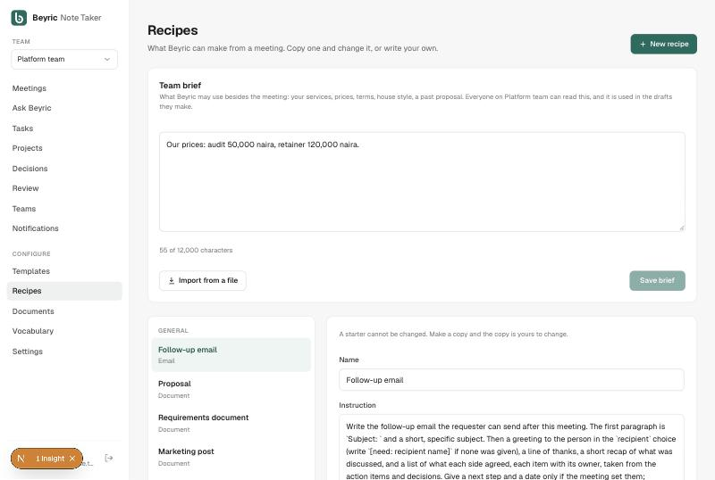
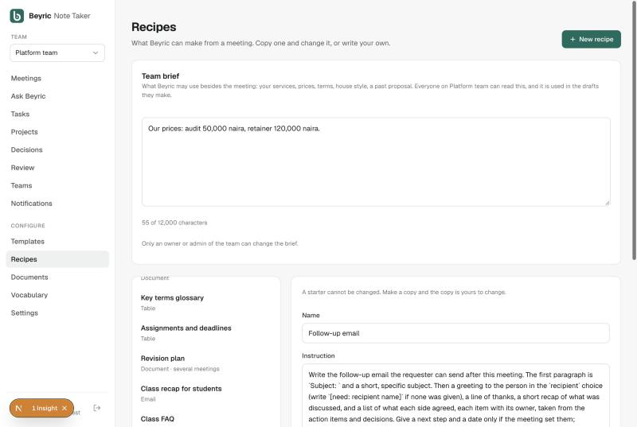
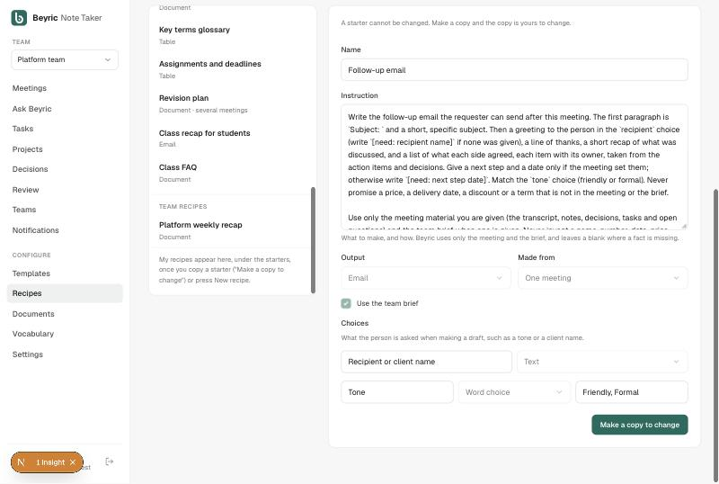
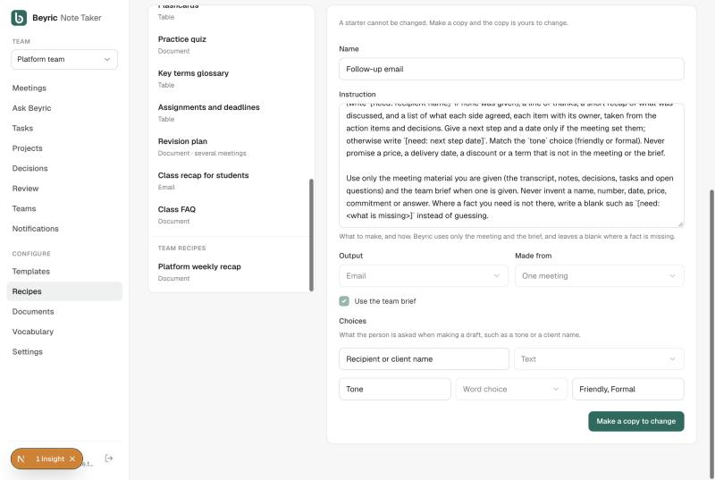
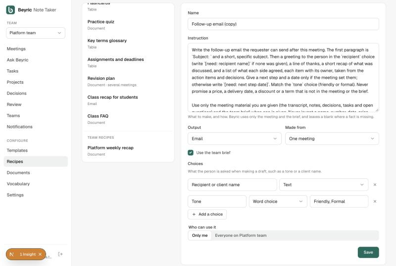
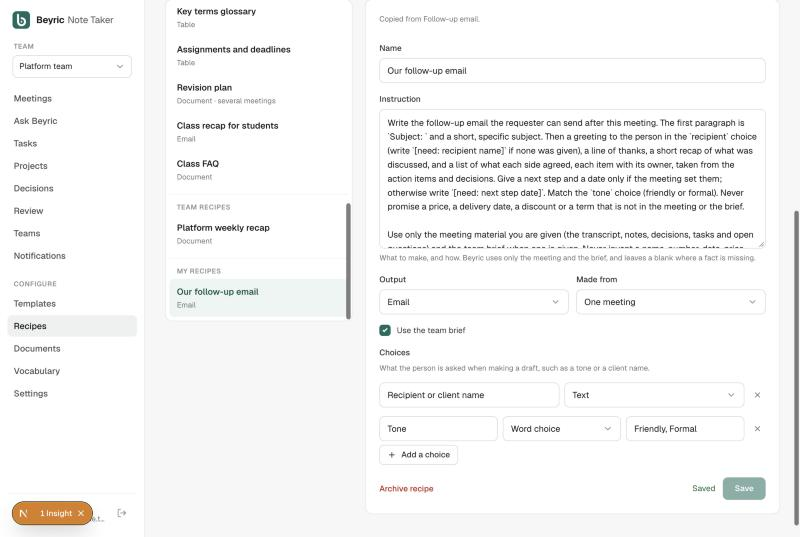
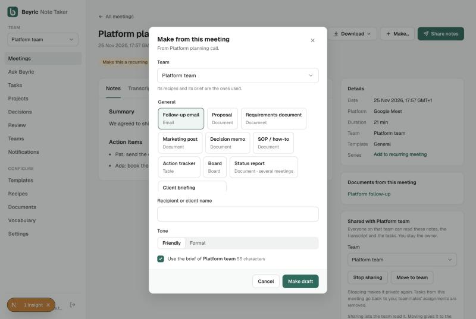
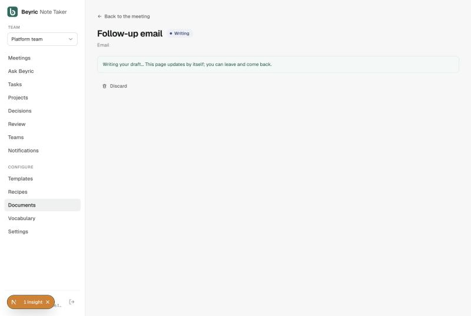
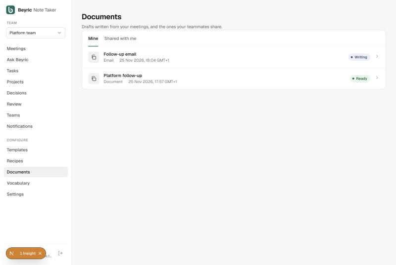
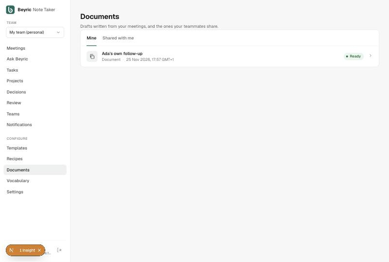

# Recipes and Documents: a walkthrough

For the owner. Plain words, no code. Everything here was seen on a real copy of the app running on a
test computer (two workspaces: "My team (personal)" and "Platform team"); the screenshots are from it.
Where something could not be tried, it says so.

## The two ideas

- A **recipe** is a written instruction that tells Beyric what to make from a meeting: a follow-up
  email, a proposal, a status report. A recipe also says the kind of result (**Output**: Document,
  Email, Table or Board), whether it uses one meeting or several (**Made from**), whether it may use
  the team brief, and the questions to ask each time (**Choices**, for example "Tone: Friendly or
  Formal").
- A **draft** is what Beyric writes when you press Make. Drafts are listed on the **Documents** page.

Every workspace is separate. The Team brief, the team recipes and the drafts you see are the ones of
the workspace named in the box at the top of the left sidebar. Switch the box and the pages change
with it.

## The Team brief

The **Team brief** is one box of text about your business: services, prices, terms, house style.
Beyric may use it, besides the meeting, when it writes a draft. Each workspace has its own brief.

- Everyone in the workspace can **read** it. Only an **owner or admin** can change it (a member sees
  "Only an owner or admin of the team can change the brief.", screenshot 10).
- A draft uses it only when the box "Use the brief of ..." is ticked in the Make window.

## The list of recipes, and why "My recipes" and "Team recipes" seem to be missing

The list on the left of the Recipes page has up to four groups, in this order:

| Group | What is in it | Can you change it? |
|---|---|---|
| **General**, **School** | The starters that come with Beyric (about twenty) | No. Copy one first. |
| **Team recipes** | Recipes saved for everyone in this workspace | Only an owner or admin |
| **My recipes** | Recipes only you can use | Yes |

A group **only appears once it has something in it**. A new workspace shows only the starters, and
they are many, so Team recipes and My recipes sit right at the **bottom of the list**: scroll the
list. (This change adds a short line at the bottom of the list that says so, screenshot 09.)

### Why the fields look greyed out

Click a starter and the right-hand side shows its Output, Made from, "Use the team brief" and
Choices **greyed out**, with this line at the top: "A starter cannot be changed. Make a copy and the
copy is yours to change." Nothing is broken: a starter is read-only.

### Make a copy and save it

1. Click a starter, then press **Make a copy to change** (the green button at the bottom of the right
   side).
2. The copy opens with "(copy)" after its name and every field open for you to change.
3. Change the name and the instruction as you like. "Who can use it" says **Only me** or **Everyone
   on <workspace>**. (Only an owner or admin is offered the second.)
4. Press **Save**. It says "Saved" and the recipe now sits under **My recipes** (screenshots 03, 04).

Seen on the test copy: a recipe saved as **Only me** also shows in your other workspaces (your own
recipes follow you). **Not tried:** saving a copy as "Everyone on the workspace" from a fresh copy
(the team recipe in the screenshots was already there); the list shows it under Team recipes.

## Make, on a meeting

Open a meeting that has notes and press **Make...** (top right). The window "Make from this meeting"
shows:

- **Team**: the workspace whose recipes and brief are used ("Its recipes and its brief are the ones
  used.").
- The recipes to pick from (the same groups as the Recipes page).
- The recipe's **Choices** (here Recipient or client name, and Tone: Friendly or Formal).
- **Use the brief of <workspace>** with its size. Untick it to leave the brief out.
- **Make draft.**

Here the fields are **not** greyed out: Output and Made from are decided by the recipe, so only the
Choices and the brief tick are yours.

After **Make draft** the draft page opens with "Writing your draft... This page updates by itself;
you can leave and come back."

(On the test computer the writer was not running, so the page stayed on "Writing" and we did not see
a finished draft here. A finished draft was seen in an earlier live run, `docs/fe-integration-guide-recipes.md`.)

## Where the result lands: Documents

**Documents** in the sidebar lists the drafts of the workspace you are in.

- **Mine**: drafts you made **in this workspace**. A draft made from a meeting in Platform team is
  under Mine only while Platform team is selected.
- **Shared with me**: drafts a teammate shared with this workspace. You can read them, not change them.

Opening a draft from a link (an email, the "Documents from this meeting" card) while another
workspace is selected moves you to the workspace the draft was made in and says **"Switched to
<workspace>"**.

**Not tried live:** sharing. By the rule in the code, a draft made in your personal workspace cannot
be shared ("This draft was made in your own space. Make it in a team workspace to share it with that
team.").

## What was wrong, in one sentence

The Documents, Recipes, Ask and Notifications pages did not remember which workspace you had chosen
when they first loaded, so they showed the default workspace's drafts and brief until something else
on the page asked again. They now follow the box in the sidebar, the same way Tasks and Projects do.
