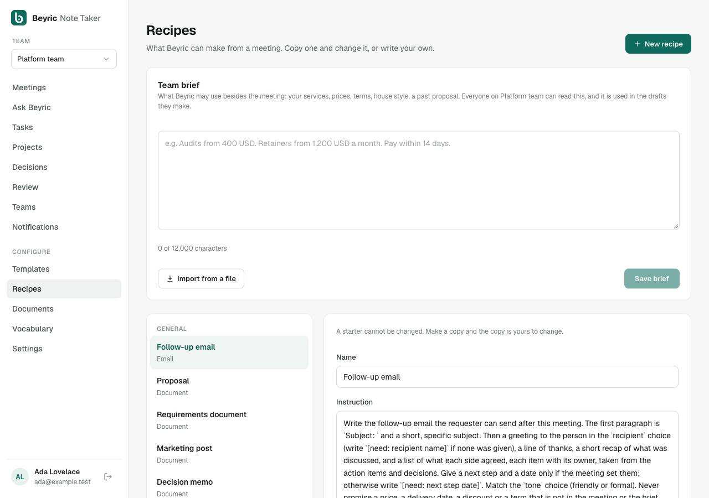
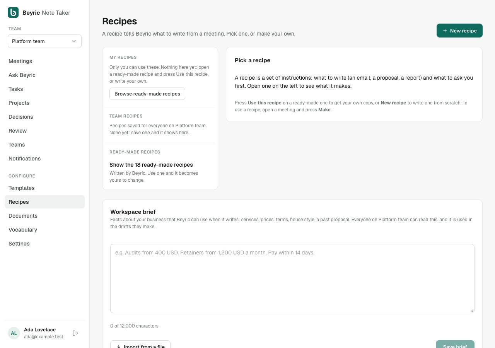
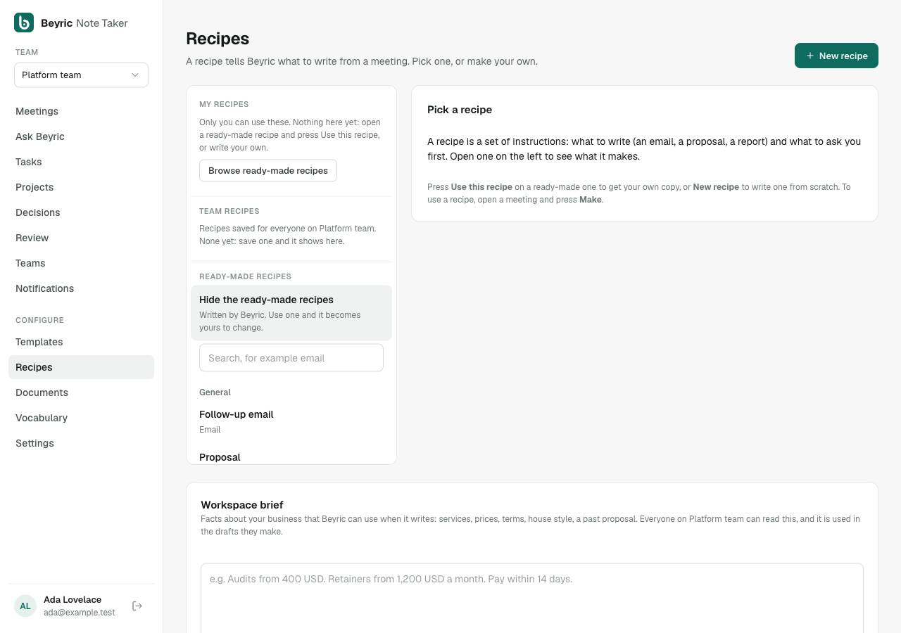
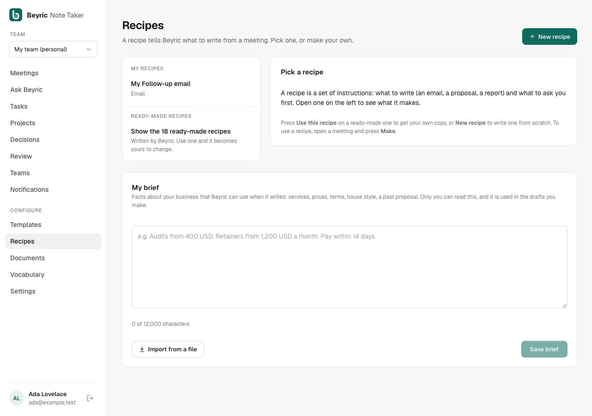
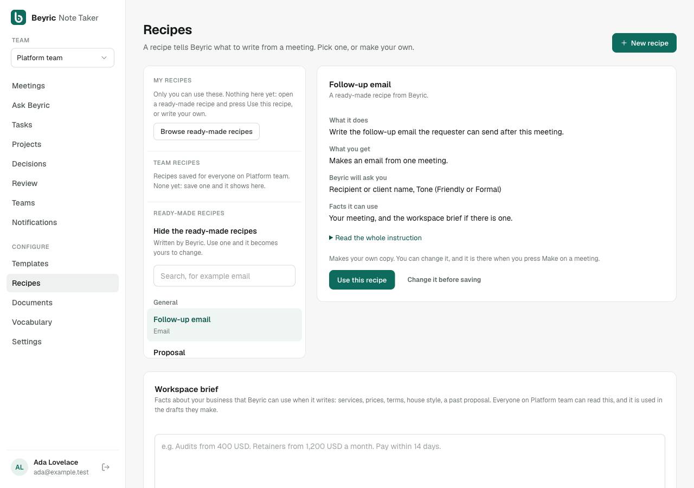
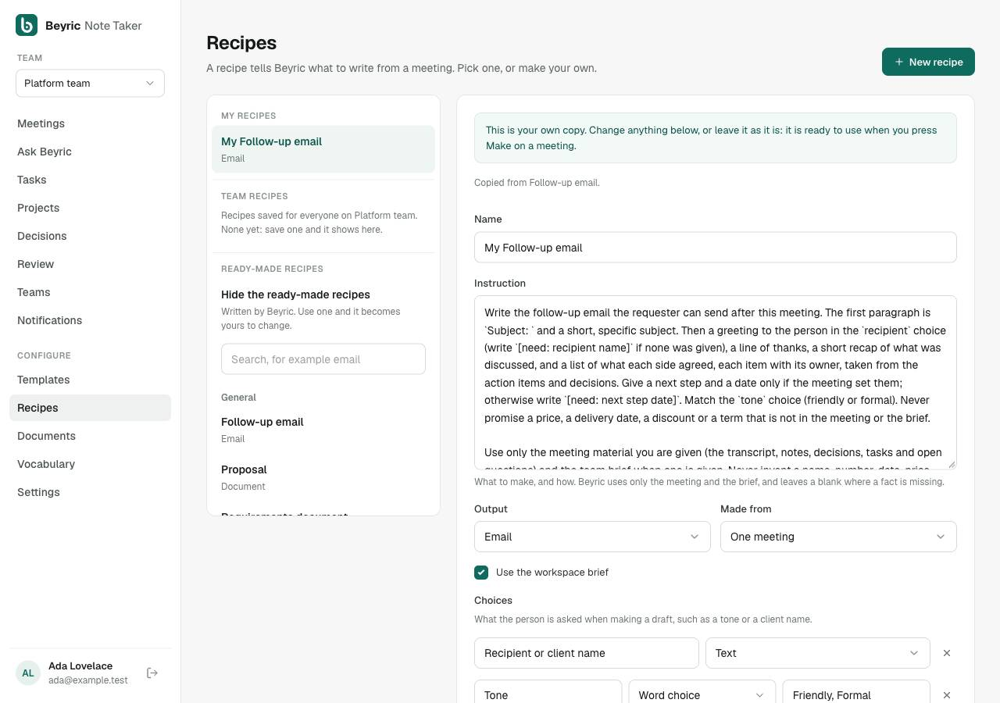
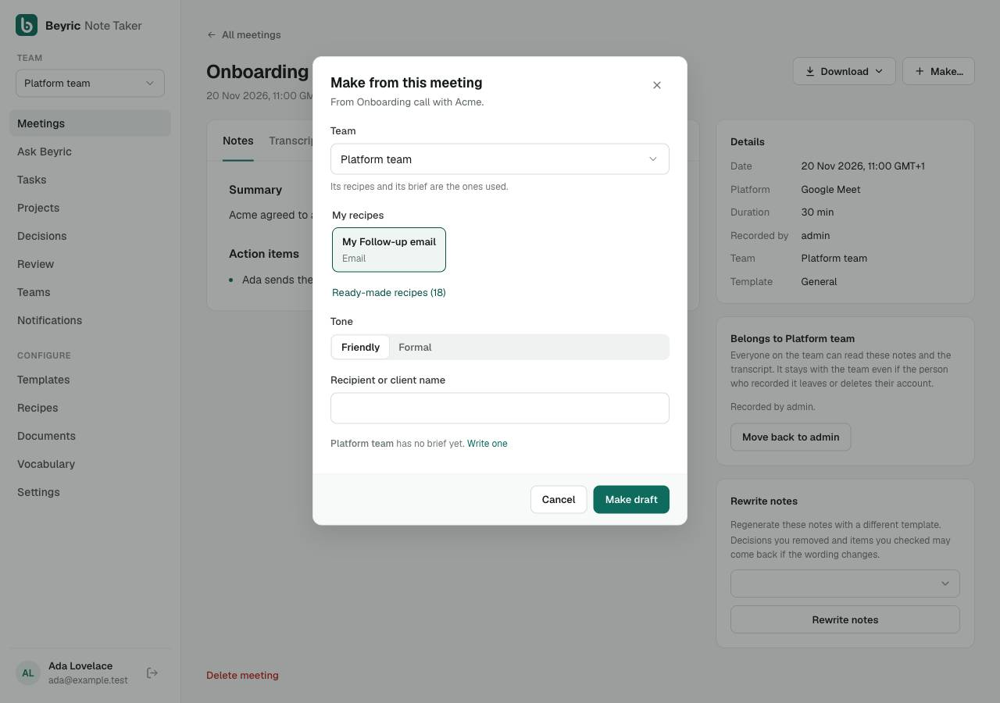

# Recipes and Documents: a walkthrough

For the owner. Plain words, no code. Everything here was seen on a real copy of the app running on a
test computer (two workspaces: "My team (personal)" and "Platform team"); the screenshots are from it.
Where something could not be tried, it says so.

## The two ideas

- A **recipe** is a written instruction that tells Beyric what to make from a meeting: a follow-up
  email, a proposal, a status report. A recipe also says the kind of result (**Output**: Document,
  Email, Table or Board), whether it uses one meeting or several (**Made from**), whether it may use
  the brief, and the questions to ask each time (**Choices**, for example "Tone: Friendly or
  Formal").
- A **draft** is what Beyric writes when you press Make. Drafts are listed on the **Documents** page.

Every workspace is separate. The workspace brief, the team recipes and the drafts you see are the ones of
the workspace named in the box at the top of the left sidebar. Switch the box and the pages change
with it.

## The Recipes page, top to bottom

*Before (the page as it was): the brief box first, then a list of twenty ready-made recipes, with "My
recipes" and "Team recipes" hidden at the bottom.*

*Now.* The page says in one line what a recipe is ("A recipe tells Beyric what to write from a
meeting. Pick one, or make your own."). Down the left:

| Block | What is in it | Empty state |
|---|---|---|
| **My recipes** | Recipes only you can use (your copies and the ones you wrote) | "Only you can use these. Nothing here yet: open a ready-made recipe and press Use this recipe, or write your own." and one button, **Browse ready-made recipes** |
| **Team recipes** | Recipes saved for everyone in this workspace. Only shown in a team workspace, or once there is one. Only an owner or admin can change them. | "Recipes saved for everyone on <workspace>. None yet: save one and it shows here." (a member is told "an owner or admin can save one") |
| **Ready-made recipes** | The 18 recipes that come with Beyric (General and School). **Shut** until you press "Show the 18 ready-made recipes"; once open there is a search box. | |

On the right, until you pick something, a short note says what to do. The **brief** sits under the
recipes, not above them.

### The brief

The brief is one box of text about your business: services, prices, terms, house style. It is
called **Workspace brief** in a team workspace and **My brief** in your own space ("My team
(personal)"), and says "Facts about your business that Beyric can use when it writes". Beyric may use
it, besides the meeting, when it writes a draft. Each workspace has its own brief.

- Everyone in a team workspace can **read** it. Only an **owner or admin** can change it (a member
  sees "Only an owner or admin of the team can change the brief."). In your own space only you can
  read it.
- A draft uses it only when the box "Use the brief of ..." is ticked in the Make window.

### Use a ready-made recipe

Open one from the list. The right side now **describes** it, in words, instead of showing greyed-out
fields:

- **What it does**: the first sentence of its instruction. **Read the whole instruction** opens the
  rest.
- **What you get**: "Makes an email from one meeting." (a document, an email, a table or a board; one
  meeting or several).
- **Beyric will ask you**: its choices, for example "Recipient or client name, Tone (Friendly or
  Formal)".
- **Facts it can use**: your meeting, and the workspace brief (or "my brief") if there is one.

Press **Use this recipe**. One click makes **your own copy**, named "My <recipe name>", opens it
for changes under **My recipes** and says "This is your own copy. Change anything below, or leave it
as it is: it is ready to use when you press Make on a meeting." Nothing else is needed: the copy is
saved already. (Seen live: the copy was in the list and in the Make window straight away.)

- To change it, edit the name or the instruction and press **Save**. It is only for you.
- **Change it before saving** (the quiet button next to Use this recipe) opens the copy *unsaved*,
  as before. This is the way to make a recipe **Everyone on <workspace>** instead of **Only me**
  (only an owner or admin is offered that).
- The same buttons appear on a team recipe a member reads: "Use this recipe" makes the member's own
  copy.

Seen on the test copy: a recipe saved as **Only me** also shows in your other workspaces (your own
recipes follow you). **Not tried:** saving a copy as "Everyone on the workspace" from a fresh copy;
the list shows it under Team recipes.

On a phone (390 px wide) the list, the right side and the brief stack one under another, with no
sideways scroll (`img/after-recipes-6-phone.jpg`).

## Make, on a meeting

Open a meeting that has notes and press **Make...** (top right). The window "Make from this meeting"
shows:

- **Team**: the workspace whose recipes and brief are used ("Its recipes and its brief are the ones
  used.").
- **My recipes** first, then **Team recipes**, each as a small card. The ready-made recipes are
  behind **Ready-made recipes (18)**, shut as soon as you have a recipe of your own or your team's.
  The recipe you made last in this browser is already chosen, even a ready-made one (it then shows
  its group open). With none of your own, the ready-made ones are open as before.
- The recipe's **Choices** (here Tone: Friendly or Formal, and Recipient or client name).
- **Use the brief of <workspace>** with its size, or "<workspace> has no brief yet. Write one".
- **Make draft.**

*Before:* the 18 ready-made recipes came first and the person's own at the bottom (screenshot from
the first version of this guide: `img/before-make-dialog.jpg`).

Here the fields are **not** greyed out: Output and Made from are decided by the recipe, so only the
Choices and the brief tick are yours.

After **Make draft** the draft page opens with "Writing your draft... This page updates by itself;
you can leave and come back."

(On the test computer the writer was not running, so the page stayed on "Writing" and we did not see
a finished draft here. A finished draft was seen in an earlier live run, `docs/fe-integration-guide-recipes.md`.)

## Where the result lands: Documents

**Documents** in the sidebar lists the drafts of the workspace you are in.

- **Mine**: drafts you made **in this workspace**. A draft made from a meeting in Platform team is
  under Mine only while Platform team is selected.
- **Shared with me**: drafts a teammate shared with this workspace. You can read them, not change them.

Opening a draft from a link (an email, the "Documents from this meeting" card) while another
workspace is selected moves you to the workspace the draft was made in and says **"Switched to
<workspace>"**.

**Not tried live:** sharing. By the rule in the code, a draft made in your personal workspace cannot
be shared ("This draft was made in your own space. Make it in a team workspace to share it with that
team.").

## What was wrong, in one sentence

The Documents, Recipes, Ask and Notifications pages did not remember which workspace you had chosen
when they first loaded, so they showed the default workspace's drafts and brief until something else
on the page asked again. They now follow the box in the sidebar, the same way Tasks and Projects do.
